<picture>
  <source media="(prefers-color-scheme: dark)" srcset="assets/header-dark.svg">
  
</picture>

Information Systems student at **King Saud University** (GPA 4.3/5) and a developer who ships software end to end, from Rust desktop apps to self-hosted web services.

📌 **Open to a full-time co-op in Riyadh, starting December 2026.** &nbsp;·&nbsp; 🌐 [n3trunner.dev](https://n3trunner.dev)

---

### Featured work

| Project | What it is | Built with |
|---|---|---|
| [**Organize for Me**](https://github.com/TR4IS/organize-for-me) | Desktop file organizer that never deletes or overwrites a file, with full undo. **<!--downloads-->1,474<!--/downloads--> installer downloads** (live count, updated daily by a GitHub Action). [Website](https://n3trunner.dev/organizeforme) | Rust, Tauri, GitHub Actions |
| [**Plate**](https://github.com/TR4IS/plate) | Snap a meal and an AI estimates the macros; workout tracker that works offline. Multi-user, three switchable AI providers. [Live demo](https://n3trunner.dev/plate) | Node.js, SQLite, Docker |
| [**ScamGuard**](https://github.com/TR4IS/ScamGaurdBot) | Discord bot that removes scam messages and images using weighted rules, image hashing and optional AI | Node.js, LLM APIs, Docker |
| [**Windows Optimizer**](https://github.com/TR4IS/WindowsOptimizer) | Open-source tool that reduces background load and latency on Windows | Python |

### Tech I use

**Languages:** Rust · JavaScript (Node.js) · Python · C# · C · SQL
**Infrastructure:** Docker · Linux · Cloudflare Tunnel · Tailscale · GitHub Actions
**AI:** Claude, OpenAI and Gemini APIs

The header is hand-written SVG with pure CSS animation: no GIFs, no third-party services. It switches with your GitHub theme. <!--updated-->Stats last updated: 2026-11-10<!--/updated-->
